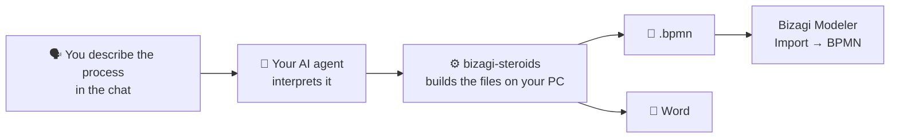

# bizagi-steroids

<p align="center">
  <a href="README.md">🇪🇸 Español</a> | <a href="README.en.md">🇺🇸 English</a>
</p>

<p align="center">
  
  
  
  
  
  
</p>

<p align="center">
  <a href="https://github.com/kennedy122112/bizagi-steroids/stargazers"></a>
  <a href="https://github.com/kennedy122112/bizagi-steroids/actions/workflows/validate.yml"></a>
  
  
</p>

<p align="center">
  
</p>

<p align="center">
  <b>Describe your process the way you'd say it. Your AI agent models it, documents it in Word and gets it ready to import into Bizagi.</b><br>
  Free and open source. No coding needed.
</p>

<p align="center"><sub>Independent project, not affiliated with Bizagi. Bizagi and Bizagi Modeler are trademarks of their respective owners.</sub></p>

---

## ✨ What it is

**bizagi-steroids** is a *skill*: a package of instructions and tools that teaches your AI assistant to model processes for **Bizagi Modeler**. You describe the process in your own words, the way you would in a meeting, and you get:

- 📐 The **BPMN 2.0 diagram** (`.bpmn`), ready to import into Bizagi.
- 📄 The **Word document**: roles, activities, decisions, deadlines, and assumptions to confirm. It can use your organization's template.
- 🖼️ A **preview** of the diagram, so you can check it without opening Bizagi.

<p align="center">
  
</p>

## 🧭 How it works



Your **AI agent** (Claude Code, Codex, OpenCode, Gemini or Cursor) understands what you say. **bizagi-steroids** runs on your computer and builds the diagram and the document. You don't write code or draw anything.

## 🧰 What you need

| You need | What for | Do I have it? |
|---|---|---|
| **Bizagi Modeler** | Opening the diagram. Tested with version 4.1. | You already use it |
| **An AI agent** | Understanding your description | See [step 3](#3-pick-your-ai-agent) |
| **Node.js 18 or later** | Installing the skill with one command | `node --version` |
| **Python 3.9 or later** | Building the files | `python --version` |
| **Chrome or Edge** (optional) | The `.png` image preview | You probably have it |

## 🚀 Step-by-step install

### 1. Install Node.js

Download it from **[nodejs.org](https://nodejs.org)**: pick the **LTS** version and install it with the default options.

### 2. Install Python

Download it from **[python.org/downloads](https://www.python.org/downloads/)**.

> ⚠️ **On Windows**, on the installer's first screen tick **"Add python.exe to PATH"** before clicking *Install Now*. If you don't, the skill won't find Python.

### 3. Pick your AI agent

If you already use one of these, skip this step:

| Agent | Where to get it |
|---|---|
| **Claude Code** | [claude.com/claude-code](https://claude.com/claude-code) |
| **Codex** | [github.com/openai/codex](https://github.com/openai/codex) |
| **OpenCode** | [opencode.ai](https://opencode.ai) |
| **Gemini CLI** | [github.com/google-gemini/gemini-cli](https://github.com/google-gemini/gemini-cli) |
| **Cursor** | [cursor.com](https://cursor.com) |

Some offer free usage (for example, Gemini CLI with a Google account, or OpenCode with its free models) and others require a subscription. Check each one's current plans. With the simplest models, the agent sometimes describes the steps instead of doing them: if that happens, pick a more capable model.

### 4. Open a terminal

- **Windows:** open the Start menu, type **PowerShell** and open it.
- **Mac:** open **Terminal** (Applications → Utilities).

Check that everything is installed. Each command should answer with a version number:

```bash
node --version
python --version
```

On Mac, if `python` doesn't answer, try `python3 --version`.

### 5. Install bizagi-steroids

Copy this command into the terminal and press Enter:

```bash
npx -y github:kennedy122112/bizagi-steroids setup
```

When it finishes you'll see **"bizagi instalado (bizagi-cli …)"** and the list of agents it was set up for. One command covers all your agents at once.

### 6. Ask for your first process

Open your AI agent **in a working folder** (for example, `Documents\processes`) and write:

> *Model in Bizagi the auto-parts purchasing process: the warehouse logs the request, management approves or rejects it, purchasing requests quotes, picks a supplier and issues the order; when the goods arrive, the warehouse checks them and, if something doesn't match, it's sorted out with the supplier.*

The agent creates a subfolder named after the process, with the `.bpmn`, the preview and the Word document, and gives you the paths.

### 7. Open it in Bizagi

In Bizagi Modeler, go to the **Export/Import → Import → BPMN** tab and pick the `.bpmn`.

> ⚠️ Don't use *File → Open*: it only opens native `.bpm` files and will show *"The file is invalid or corrupt"*. Once imported, you can save it as `.bpm` with *File → Save*.

**To update** later, repeat step 5 and start a new session in your agent.

## 💬 Example requests

| What you say | What you get |
|---|---|
| *"I need the travel expense reimbursement process: the employee submits the report and finance reviews and pays"* | A minimal process with review, correction and payment, plus a list of **assumptions and open questions** in the Word document |
| *"so, the employee requests leave in the system, and if the manager doesn't answer in three days it counts as approved…"* | A boundary timer, automatic notifications and a parallel split |
| *"model IT incident handling: L1 has 30 minutes, if it isn't solved it escalates to L2…"* | Time-based escalation, a loop back to L2 and automatic closure |
| *"document this .bpmn I exported from Bizagi"* | The process Word document from your model |
| *"change the process so the area manager does the approval"* | The corrected model, ready to import again |

No special format is needed. It handles filler words, self-corrections ("no, sorry, first…"), abbreviations and one-line requests. If something important is missing, the agent asks; if you tell it to go ahead, it fills in the typical minimum and records it as an assumption.

With deadlines, exceptions, documents and systems, the result looks like this:

<p align="center">
  
</p>

## 📄 The Word document

Every process comes with its deliverable, ready for review or sign-off:
- a summary sheet with code, version and owners;
- the objective, and the roles with their activities;
- the **diagram on a landscape page** (on A3 with detail pages when it's large);
- the activities table with inputs, outputs and systems, and the step-by-step flow;
- decision rules, exceptions and deadlines, documents, and interactions with external parties;
- assumptions and open questions.

Samples: [atencion-reclamos.docx](docs/atencion-reclamos.docx) · [solicitud-compra.docx](docs/solicitud-compra.docx)

### With your organization's template

Ask the agent *"generate the Word document with my template `template.docx`"*. Everything in your template is kept: logo, cover page, headers and footers, version history, signatures and styles.

Optionally, you can put these **placeholders** in your template:

| Placeholder | Replaced with |
|---|---|
| `{{CONTENIDO}}` | All the process content. Without it, the content is appended at the end. |
| `{{nombre}}` | Process name |
| `{{codigo}}` `{{version}}` `{{fecha}}` `{{responsable}}` `{{area}}` | Summary-sheet values |
| `{{elaborado}}` `{{revisado}}` `{{aprobado}}` | Names for the sign-off block |

Anything you didn't give the agent appears as "Por completar". There's a sample template in [`plantilla-ejemplo.docx`](skills/bizagi/plantillas/plantilla-ejemplo.docx) and its output in [atencion-reclamos-plantilla.docx](docs/atencion-reclamos-plantilla.docx).

## ❓ FAQ

**Does it cost anything?**
bizagi-steroids is free and open source (MIT license). Your AI agent may cost money, depending on which one you use and its plan.

**Does my data leave my computer?**
The files (`.bpmn`, Word and preview) are built on your PC, and bizagi-steroids doesn't connect to any service. But your AI agent sends what you type in the chat to its model provider (Anthropic, OpenAI, Google, etc.), like any AI assistant. If the process includes sensitive information, check your organization's and your provider's policies.

**Do I need to know how to code?**
No. You only copy one command to install it; after that, everything is requested in plain language.

**Does it work with my Bizagi version?**
It was tested with Bizagi Modeler 4.1. It produces BPMN 2.0, the standard format Bizagi imports, so other recent versions should work the same.

**Can I change a process I already have in Bizagi?**
Yes. Export it from Bizagi (**Export/Import → Export → BPMN**), hand the file to the agent with the changes you want, and import the result again.

**What language does it work in?**
You can describe the process in Spanish or English. The Word document and the diagram texts follow the language of your description, though the Word section headings are in Spanish.

## 🩺 Troubleshooting

| Symptom | What to do |
|---|---|
| Bizagi says **"Error cargando Modelo: The file is invalid or corrupt"** | You opened it with *File → Open*. Use **Export/Import → Import → BPMN**. |
| `npx` **is not recognized** | Node.js is missing ([step 1](#1-install-nodejs)). After installing it, close and reopen the terminal. |
| **"Python not found"** | Install Python with *"Add python.exe to PATH"* ticked ([step 2](#2-install-python)) and repeat step 5. |
| The agent **shows the commands instead of running them**, or gives a path that doesn't exist | Start a new session or pick a more capable model in your agent. |
| The agent **doesn't know the skill** | Run `npx -y github:kennedy122112/bizagi-steroids status` and start a new session (in Gemini, `/skills reload`). |
| **No `.png` preview**, only `.svg` | Chrome or Edge is missing. The `.svg` opens in any browser, and the Word document still includes the diagram. |
| You see `AVISO diagrama` | A line in the diagram crosses an element. Ask the agent to reorder the lanes; very large processes may keep a crossing or two. |

## ⚠️ Limitations

- It can't read Bizagi's native `.bpm` file: export the model to BPMN first.
- Sub-processes are generated collapsed.
- A deadline that spans several activities (an SLA, for example) is attached to one activity and explained in a note.

---

## 🛠️ For developers

### Other ways to install

**As a Claude Code plugin:**

```
/plugin install bizagi --marketplace kennedy122112/bizagi-steroids
```

Or from the terminal: `claude plugin marketplace add kennedy122112/bizagi-steroids` and `claude plugin install bizagi@bizagi-steroids`.

**As a Codex plugin:** `codex plugin marketplace add kennedy122112/bizagi-steroids` and `codex plugin add bizagi@bizagi-steroids`.

**Without Node, with git:**

```powershell
irm https://raw.githubusercontent.com/kennedy122112/bizagi-steroids/main/install.ps1 | iex
```

```bash
curl -fsSL https://raw.githubusercontent.com/kennedy122112/bizagi-steroids/main/install.sh | bash
```

Use **only one method per agent**, so the skill isn't loaded twice.

### Where it's installed

`npx … setup` and the scripts keep a copy in `~/.bizagi-steroids` and link it where each agent looks for skills:

| Agent | Path | Tested |
|---|---|---|
| Claude Code | `~/.claude/skills/bizagi` | ✅ |
| Codex | `~/.agents/skills/bizagi` | ✅ (CLI 0.164) |
| OpenCode | `~/.agents/skills/bizagi` | ✅ |
| Gemini CLI / Antigravity | `~/.agents/skills/bizagi` (alias of `~/.gemini/skills`) | Detects the skill (CLI 0.40) |
| Cursor | `~/.agents/skills/bizagi` | Not tested |

To check the status: `npx -y github:kennedy122112/bizagi-steroids status`. To uninstall: `npx -y github:kennedy122112/bizagi-steroids uninstall`. Previous installs are backed up to the temp folder, not deleted.

If your agent doesn't support skills, add this to your `AGENTS.md`: *"To model Bizagi processes, follow `~/.agents/skills/bizagi/SKILL.md`."*

### Commands

The tool also works without an agent (`python skills/bizagi/scripts/bizagi_cli.py <command>`):

| Command | Purpose |
|---|---|
| `build spec.json [-d folder] [--template template.docx]` | **All in one:** BPMN, preview and Word, and prints the created paths |
| `generate spec.json -o process.bpmn --svg preview.svg` | spec → BPMN that Bizagi can import |
| `read model.bpmn -o spec.json` | BPMN exported from Bizagi → editable spec |
| `validate spec.json\|model.bpmn` | Modeling rules (start and end events, unlabeled gateway outputs, unreachable nodes…) |
| `preview spec.json\|model.bpmn -o preview.png` | Diagram to review (`.png` needs Chrome or Edge; `.svg` always works) |
| `doc spec.json\|model.bpmn -o doc.md` | Markdown documentation |
| `docx spec.json\|model.bpmn -o process.docx [--template template.docx]` | Word document |

It only uses the Python 3.9+ standard library. The spec format and the modeling rules are described in [SKILL.md](skills/bizagi/SKILL.md).

**Supported elements:**
- Pools and lanes, including external pools, and message flows.
- Start, end, timer, message, signal, error and terminate events, plus boundary events (interrupting or not).
- Every task type, and sub-processes.
- Exclusive, parallel, inclusive, event-based and complex gateways, with conditions and default flows.
- Data objects, data stores and annotations.

### Tests

- **Real natural language:** a transcribed voice note, an email full of jargon, meeting notes, a dictation with self-corrections and a one-line request, each modeled by an independent agent that had only the text and `SKILL.md`. They're in [`tests/`](tests/).
- **Bizagi Modeler 4.1:** the examples and several test cases were checked by importing them into Bizagi: pools and lanes, exclusive and parallel gateways, boundary timers and errors, messages, documents, data stores and annotations.
- **CI:** on every push, with Python 3.9 and 3.13, all examples and cases are validated and regenerated, and the `npx` installer is tested.

### Repo layout

| Path | Contents |
|---|---|
| `skills/bizagi/` | The skill: `SKILL.md`, `scripts/bizagi_cli.py` and `plantillas/` |
| `bin/` | `npx` installer |
| `.claude-plugin/`, `.agents/plugins/`, `.cursor-plugin/` | Plugin manifests |
| `examples/`, `docs/`, `tests/` | Examples, sample images and documents, and test cases |

## 🔗 Sibling project

[**figma-steroids**](https://github.com/kennedy122112/figma-steroids): design in Figma Desktop from your AI agent, with no API key and no MCP.

## 📄 License

[MIT](LICENSE)
