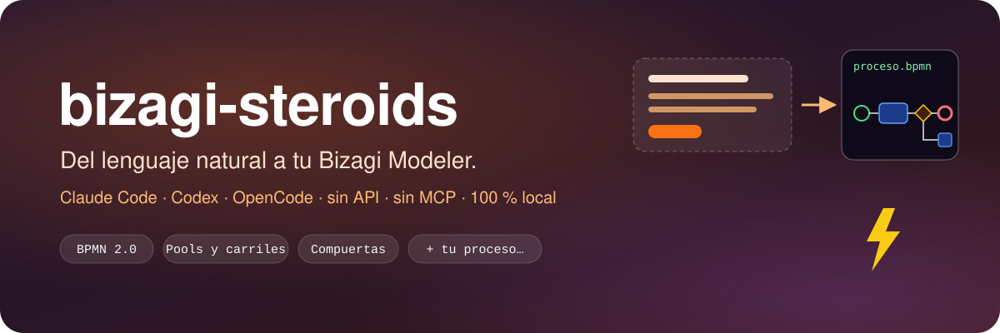
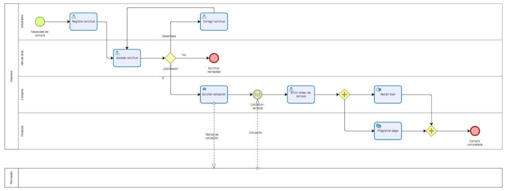
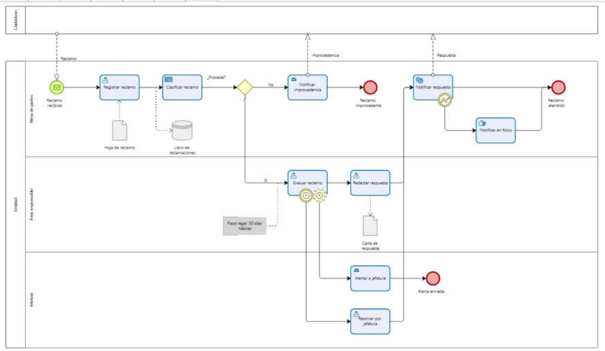

# bizagi-skill

<p align="center">
  <a href="README.md">🇪🇸 Español</a> | <a href="README.en.md">🇺🇸 English</a>
</p>

<p align="center">
  
  
  
  
  
  
</p>

<p align="center">
  <a href="https://github.com/kennedy122112/bizagi-skill/stargazers"></a>
  <a href="https://github.com/kennedy122112/bizagi-skill/actions/workflows/validate.yml"></a>
  
  
</p>

<p align="center">
  
</p>

<p align="center">
  <b>Describe your process in plain language. Your AI agent models it and gets it ready to import into Bizagi.</b><br>
  Local, no API, no MCP, no dependencies.
</p>

---

## ✨ What it does

Tell your agent (Claude Code, Codex or OpenCode) about the process:

> *The requester registers the request and the department head approves it; if it gets comments, the requester fixes it and sends it back for approval; if it is rejected, the process ends. Purchasing asks the supplier for a quote, issues the order and, in parallel, receives the goods while Finance schedules the payment.*

The agent interprets it, writes a spec, validates it and generates **BPMN 2.0 with diagram layout**. All you do is import it into Bizagi:

<p align="center">
  
</p>

It also handles deadlines, exceptions, documents and systems. For example, a complaint-handling process with boundary timers, a delivery error, a complaints register and a note about the legal deadline:

<p align="center">
  
</p>

## 📄 Word document

`docx` produces a deliverable ready for review or sign-off. It contains a summary sheet with code, version and owners, the objective, the participants, the **diagram on a landscape page** (vector, with an image fallback), the activities table with inputs and outputs, the flow, the decision rules, the exceptions and deadlines, the documents and systems, and the interactions with external parties. Pure Python, no dependencies.

Samples: [atencion-reclamos.docx](docs/atencion-reclamos.docx) · [solicitud-compra.docx](docs/solicitud-compra.docx)

## 🎨 Your own template

Use your organization's Word document (or any `.docx` or `.dotx`) as a template:

```bash
python skills/bizagi/scripts/bizagi_cli.py docx process.json -o deliverable.docx --template my-template.docx
```

Everything in your template is kept: logo, headers and footers, cover page, version history, signatures, margins and styles. The process content uses your heading styles, even if Word runs in another language, and the tables take your heading color.

Put these **placeholders** anywhere in the template, including headers and footers:

| Placeholder | Replaced with |
|---|---|
| `{{CONTENIDO}}` | All the process content: objective, roles, diagram, activities, flow… Without this placeholder, the content is appended at the end. |
| `{{nombre}}` | Process name |
| `{{codigo}}` `{{version}}` `{{fecha}}` | Values from `meta` in the spec. The date defaults to today. |
| `{{responsable}}` `{{area}}` | Values from `meta` |
| `{{elaborado}}` `{{revisado}}` `{{aprobado}}` | Values from `meta`, for the sign-off block |
| `{{any_key}}` | Any other key you add to `meta` |

Missing values appear as "Por completar". If the template already has `{{nombre}}`, the process title isn't repeated; if it has summary-sheet placeholders, the built-in summary sheet is left out.

[`skills/bizagi/plantillas/plantilla-ejemplo.docx`](skills/bizagi/plantillas/plantilla-ejemplo.docx) is a neutral starting template with a cover page, version history, approvals, and a header and footer with placeholders. Sample output: [atencion-reclamos-plantilla.docx](docs/atencion-reclamos-plantilla.docx).

## 🧰 Commands

| Command | Purpose |
|---|---|
| `generate spec.json -o process.bpmn --svg preview.svg` | spec → BPMN that Bizagi can import, plus a preview |
| `read model.bpmn -o spec.json` | BPMN exported from Bizagi → editable spec |
| `validate spec.json\|model.bpmn` | Modeling rules: start and end events, unlabeled gateway outputs, unreachable nodes… |
| `preview spec.json\|model.bpmn -o preview.svg` | SVG diagram to review without opening Bizagi |
| `doc spec.json\|model.bpmn -o doc.md` | Process documentation: roles, activities and sequence |
| `docx spec.json\|model.bpmn -o process.docx [--template template.docx]` | **Word document**: summary sheet, diagram, activities, decisions, exceptions, documents and external parties |

**Supports:**
- Pools and lanes, including external (black-box) pools, and message flows.
- Events: start, end, timer, message, signal, error and terminate.
- Boundary events on a task (timer, message, signal, conditional or error), interrupting or not.
- Every task type, and sub-processes.
- Data objects, data stores and annotations, linked by input and output associations.
- Exclusive, parallel, inclusive, event-based and complex gateways, with conditions and default flows.
- Rework loops.

Diagram positions are computed automatically.

> The spec keywords and generated documentation are in Spanish. Any language model handles them fine.

## 🚀 Install

To run the skill you need **Python 3.9 or later**. No third-party packages.

### 1. One command (recommended)

```bash
npx -y github:kennedy122112/bizagi-skill setup
```

It only needs **Node.js 18 or later**, no git. It makes the skill available to **every agent** at once, without duplicating it:

| Agent | How it finds the skill |
|---|---|
| Codex | Reads `~/.agents/skills` |
| OpenCode | Reads `~/.agents/skills` |
| Gemini CLI / Antigravity | Reads `~/.agents/skills` (alias of `~/.gemini/skills`) |
| Cursor | Reads `~/.agents/skills` |
| Claude Code | Link at `~/.claude/skills/bizagi` |

The files live in `~/.bizagi-skill`, and the agents reach them through links.
- **Update:** run the same command again.
- **Check status:** `… status`.
- **Uninstall:** `… uninstall`.

Any previous install is moved to the temp folder instead of being deleted.

### 2. As a plugin for your agent

**Claude Code:**

```
/plugin install bizagi --marketplace kennedy122112/bizagi-skill
```

On versions older than 2.1.275, or from the terminal:

```bash
claude plugin marketplace add kennedy122112/bizagi-skill
claude plugin install bizagi@bizagi-skill
```

**Codex:**

```bash
codex plugin marketplace add kennedy122112/bizagi-skill
codex plugin add bizagi@bizagi-skill
```

As a plugin, the agent updates it from its own marketplace (`/plugin marketplace update` or `codex plugin marketplace upgrade`). Use **only one method per agent**, so the skill isn't loaded twice.

### 3. Without Node: with git

**Windows (PowerShell):**

```powershell
irm https://raw.githubusercontent.com/kennedy122112/bizagi-skill/main/install.ps1 | iex
```

**macOS / Linux / Git Bash:**

```bash
curl -fsSL https://raw.githubusercontent.com/kennedy122112/bizagi-skill/main/install.sh | bash
```

They give the same result as `npx … setup`, with a git clone in `~/.bizagi-skill`.

If your agent doesn't support skills, add this to your project's `AGENTS.md`:
> *"To model Bizagi processes, follow `~/.agents/skills/bizagi/SKILL.md`."*

## 🔁 Workflow

1. **Describe** the process in plain language.
2. The agent **generates** `process.bpmn` and a preview.
3. In Bizagi: **Export/Import → Import → BPMN**.
4. **To change an existing model**, export it from Bizagi (**Export → BPMN**), hand the file to the agent with the changes you want, then import the result again.

You can also use the tool without an agent:

```bash
python skills/bizagi/scripts/bizagi_cli.py generate examples/solicitud-compra.json -o process.bpmn --svg process.svg
```

The spec format and the modeling rules are described in [SKILL.md](skills/bizagi/SKILL.md).

## 🧪 Natural-language tests

The skill was tested on processes described the way people actually write or dictate them: a transcribed voice note, an email full of jargon, meeting notes with abbreviations, a dictation with self-corrections, and a one-line request. An independent agent modeled each case using only the text and `SKILL.md`, and the problems it found were fixed in v0.4.0. The cases and their specs are in [`tests/`](tests/), and CI regenerates them on every push.

## ⚠️ Limitations

- It can't read Bizagi's native `.bpm` file. Export the model to BPMN first.
- Sub-processes are generated collapsed.

## 📄 License

[MIT](LICENSE)
