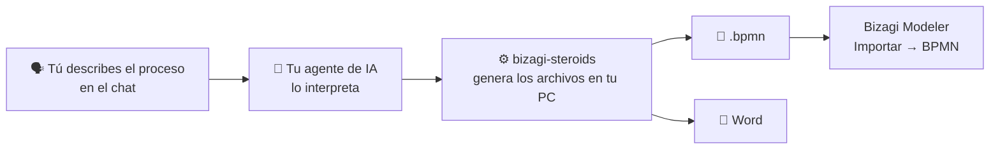

# bizagi-steroids

<p align="center">
  <a href="README.md">🇪🇸 Español</a> | <a href="README.en.md">🇺🇸 English</a>
</p>

<p align="center">
  
  
  
  
  
  
</p>

<p align="center">
  <a href="https://github.com/kennedy122112/bizagi-steroids/stargazers"></a>
  <a href="https://github.com/kennedy122112/bizagi-steroids/actions/workflows/validate.yml"></a>
  
  
</p>

<p align="center">
  
</p>

<p align="center">
  <b>Describe tu proceso como lo hablas. Tu agente de IA lo modela, lo documenta en Word y lo deja listo para importarlo en Bizagi.</b><br>
  Gratis y de código abierto. Sin programar.
</p>

<p align="center"><sub>Proyecto independiente, no afiliado a Bizagi. Bizagi y Bizagi Modeler son marcas de sus respectivos titulares.</sub></p>

---

## ✨ Qué es

**bizagi-steroids** es un *skill*: un paquete de instrucciones y herramientas que le enseña a tu asistente de IA a modelar procesos para **Bizagi Modeler**. Le cuentas el proceso con tus palabras, igual que en una reunión, y te entrega:

- 📐 El **diagrama BPMN 2.0** (`.bpmn`), listo para importar en Bizagi.
- 📄 El **documento en Word**: roles, actividades, decisiones, plazos y supuestos por validar. Puede ir con la plantilla de tu organización.
- 🖼️ Una **vista previa** del diagrama, para revisarlo sin abrir Bizagi.

<p align="center">
  
</p>

## 🧭 Cómo funciona



Tu **agente de IA** (Claude Code, Codex, OpenCode, Gemini o Cursor) entiende lo que dices. **bizagi-steroids** se ejecuta en tu computadora y genera el diagrama y el documento. No tienes que escribir código ni dibujar nada.

## 🧰 Qué necesitas

| Necesitas | Para qué | ¿Lo tengo? |
|---|---|---|
| **Bizagi Modeler** | Abrir el diagrama. Probado con la versión 4.1. | Ya lo usas |
| **Un agente de IA** | Entender tu descripción | Ver el [paso 3](#3-elige-tu-agente-de-ia) |
| **Node.js 18 o superior** | Instalar el skill con un comando | `node --version` |
| **Python 3.9 o superior** | Generar los archivos | `python --version` |
| **Chrome o Edge** (opcional) | La vista previa en imagen `.png` | Normalmente ya lo tienes |

## 🚀 Instalación paso a paso

### 1. Instala Node.js

Descárgalo de **[nodejs.org](https://nodejs.org)**: elige la versión **LTS** e instálalo con las opciones por defecto.

### 2. Instala Python

Descárgalo de **[python.org/downloads](https://www.python.org/downloads/)**.

> ⚠️ **En Windows**, en la primera pantalla del instalador marca **"Add python.exe to PATH"** antes de pulsar *Install Now*. Si no lo marcas, el skill no encontrará Python.

### 3. Elige tu agente de IA

Si ya usas uno de estos, sáltate este paso:

| Agente | Dónde conseguirlo |
|---|---|
| **Claude Code** | [claude.com/claude-code](https://claude.com/claude-code) |
| **Codex** | [github.com/openai/codex](https://github.com/openai/codex) |
| **OpenCode** | [opencode.ai](https://opencode.ai) |
| **Gemini CLI** | [github.com/google-gemini/gemini-cli](https://github.com/google-gemini/gemini-cli) |
| **Cursor** | [cursor.com](https://cursor.com) |

Algunos tienen uso gratuito (por ejemplo, Gemini CLI con una cuenta de Google, u OpenCode con sus modelos gratuitos) y otros requieren una suscripción. Revisa los planes vigentes de cada uno. Con los modelos más simples, el agente a veces describe los pasos en vez de hacerlos: si te pasa, elige un modelo más capaz.

### 4. Abre una terminal

- **Windows:** abre el menú Inicio, escribe **PowerShell** y ábrelo.
- **Mac:** abre **Terminal** (Aplicaciones → Utilidades).

Comprueba que todo está instalado. Cada comando debe responder con un número de versión:

```bash
node --version
python --version
```

En Mac, si `python` no responde, prueba con `python3 --version`.

### 5. Instala bizagi-steroids

Copia este comando en la terminal y pulsa Enter:

```bash
npx -y github:kennedy122112/bizagi-steroids setup
```

Al terminar verás **"bizagi instalado (bizagi-cli …)"** y la lista de agentes donde quedó disponible. Un solo comando sirve para todos tus agentes a la vez.

### 6. Pide tu primer proceso

Abre tu agente de IA **en una carpeta de trabajo** (por ejemplo, `Documentos\procesos`) y escríbele:

> *Modela en Bizagi el proceso de compra de autopartes: almacén registra la solicitud, gerencia la aprueba o la rechaza, compras pide cotizaciones, elige proveedor y emite la orden; al llegar, almacén verifica y, si algo no está conforme, se coordina con el proveedor.*

El agente crea una subcarpeta con el nombre del proceso, con el `.bpmn`, la vista previa y el Word, y te da las rutas.

### 7. Ábrelo en Bizagi

En Bizagi Modeler, ve a la pestaña **Exportar/Importar → Importar → BPMN** y elige el `.bpmn`.

> ⚠️ No uses *Archivo → Abrir*: esa opción solo abre archivos nativos `.bpm` y mostrará *"The file is invalid or corrupt"*. Una vez importado, puedes guardarlo como `.bpm` con *Archivo → Guardar*.

**Para actualizar** más adelante, repite el paso 5 y abre una sesión nueva en tu agente.

## 💬 Ejemplos de pedidos

| Lo que dices | Lo que obtienes |
|---|---|
| *"necesito el proceso de reembolso de gastos de viaje, el empleado presenta su rendición y finanzas revisa y paga"* | Un proceso mínimo con revisión, corrección y pago, y una lista de **supuestos y preguntas por validar** en el Word |
| *"bueno mira, el trabajador pide sus vacaciones en el sistema, si el jefe no responde en tres días se da por aprobado…"* | Un temporizador adjunto, notificaciones automáticas y un paralelismo |
| *"modela la atención de incidencias de TI: N1 tiene 30 min, si no resuelve escala a N2…"* | Escalamiento por tiempo, regreso a N2 y cierre automático |
| *"documenta este .bpmn que exporté de Bizagi"* | El Word del proceso a partir de tu modelo |
| *"cámbiale al proceso que la aprobación la haga el gerente de área"* | El modelo corregido, listo para volver a importar |

No hace falta un formato especial. Entiende muletillas, correcciones ("no, perdón, primero…"), abreviaturas y pedidos de una sola línea. Si falta algo importante, el agente pregunta; si le pides avanzar, completa con lo mínimo típico y lo anota como supuesto.

Con plazos, excepciones, documentos y sistemas, el resultado se ve así:

<p align="center">
  
</p>

## 📄 El documento Word

Cada proceso trae su entregable, listo para revisar o firmar:
- una ficha con código, versión y responsables;
- el objetivo y los roles con sus actividades;
- el **diagrama en una página horizontal** (en A3 con páginas de detalle si es grande);
- la tabla de actividades con entradas, salidas y sistemas, y el flujo paso a paso;
- las reglas de decisión, las excepciones y plazos, los documentos y las interacciones con externos;
- los supuestos y puntos por validar.

Ejemplos: [atencion-reclamos.docx](docs/atencion-reclamos.docx) · [solicitud-compra.docx](docs/solicitud-compra.docx)

### Con la plantilla de tu organización

Pídele al agente *"genera el Word con mi plantilla `plantilla.docx`"*. De tu plantilla se conserva todo: logo, carátula, encabezados y pies, control de versiones, firmas y estilos.

Opcionalmente, puedes escribir estos **marcadores** en tu plantilla:

| Marcador | Se reemplaza por |
|---|---|
| `{{CONTENIDO}}` | Todo el contenido del proceso. Sin este marcador, se agrega al final. |
| `{{nombre}}` | Nombre del proceso |
| `{{codigo}}` `{{version}}` `{{fecha}}` `{{responsable}}` `{{area}}` | Datos de la ficha |
| `{{elaborado}}` `{{revisado}}` `{{aprobado}}` | Nombres para el bloque de firmas |

Lo que no le hayas dicho al agente aparece como "Por completar". Hay una plantilla de ejemplo en [`plantilla-ejemplo.docx`](skills/bizagi/plantillas/plantilla-ejemplo.docx) y su resultado en [atencion-reclamos-plantilla.docx](docs/atencion-reclamos-plantilla.docx).

## ❓ Preguntas frecuentes

**¿Cuesta algo?**
bizagi-steroids es gratuito y de código abierto (licencia MIT). Lo que puede tener costo es tu agente de IA, según el que elijas y su plan.

**¿Mis datos salen de mi computadora?**
Los archivos (`.bpmn`, Word y vista previa) se generan en tu PC, y bizagi-steroids no se conecta a ningún servicio. Pero tu agente de IA envía lo que escribes en el chat al proveedor de su modelo (Anthropic, OpenAI, Google, etc.), como cualquier asistente de IA. Si el proceso tiene información sensible, revisa las políticas de tu organización y de tu proveedor.

**¿Necesito saber programar?**
No. Solo necesitas copiar un comando para instalarlo; después todo se pide en lenguaje natural.

**¿Funciona con mi versión de Bizagi?**
Se probó con Bizagi Modeler 4.1. Genera BPMN 2.0, el formato estándar que Bizagi importa, así que en otras versiones recientes debería funcionar igual.

**¿Puedo modificar un proceso que ya tengo en Bizagi?**
Sí. Expórtalo desde Bizagi (**Exportar/Importar → Exportar → BPMN**), pásale el archivo al agente con los cambios que quieres y vuelve a importar el resultado.

**¿En qué idioma funciona?**
Puedes describir el proceso en español o en inglés. El Word y los textos del diagrama salen en el idioma de tu descripción, aunque los títulos de las secciones del Word están en español.

## 🩺 Solución de problemas

| Síntoma | Qué hacer |
|---|---|
| Bizagi dice **"Error cargando Modelo: The file is invalid or corrupt"** | Lo abriste con *Archivo → Abrir*. Usa **Exportar/Importar → Importar → BPMN**. |
| `npx` **no se reconoce** como comando | Falta Node.js ([paso 1](#1-instala-nodejs)). Después de instalarlo, cierra y vuelve a abrir la terminal. |
| **"no se encontró Python"** | Instala Python marcando *"Add python.exe to PATH"* ([paso 2](#2-instala-python)) y repite el paso 5. |
| El agente **muestra los comandos en vez de ejecutarlos**, o da una ruta que no existe | Abre una sesión nueva o elige un modelo más capaz en tu agente. |
| El agente **no conoce el skill** | Ejecuta `npx -y github:kennedy122112/bizagi-steroids status` y abre una sesión nueva (en Gemini, `/skills reload`). |
| **No hay vista previa `.png`**, solo `.svg` | Falta Chrome o Edge. El `.svg` se abre en cualquier navegador y el Word lleva el diagrama igual. |
| Aparece `AVISO diagrama` | Alguna línea del diagrama cruza un elemento. Pídele al agente que reordene los carriles; en procesos muy grandes puede quedar algún cruce. |

## ⚠️ Limitaciones

- No lee el archivo nativo `.bpm` de Bizagi: hay que exportar el modelo a BPMN.
- Los subprocesos se generan contraídos.
- Un plazo que abarca varias actividades (por ejemplo, un SLA) se adjunta a una actividad y se explica en una nota.

---

## 🛠️ Para desarrolladores

### Otras formas de instalar

**Como plugin de Claude Code:**

```
/plugin install bizagi --marketplace kennedy122112/bizagi-steroids
```

O desde la terminal: `claude plugin marketplace add kennedy122112/bizagi-steroids` y `claude plugin install bizagi@bizagi-steroids`.

**Como plugin de Codex:** `codex plugin marketplace add kennedy122112/bizagi-steroids` y `codex plugin add bizagi@bizagi-steroids`.

**Sin Node, con git:**

```powershell
irm https://raw.githubusercontent.com/kennedy122112/bizagi-steroids/main/install.ps1 | iex
```

```bash
curl -fsSL https://raw.githubusercontent.com/kennedy122112/bizagi-steroids/main/install.sh | bash
```

Usa **un solo método por agente**, para no cargar el skill dos veces.

### Dónde se instala

`npx … setup` y los scripts dejan una copia en `~/.bizagi-steroids` y la enlazan donde la busca cada agente:

| Agente | Ruta | Probado |
|---|---|---|
| Claude Code | `~/.claude/skills/bizagi` | ✅ |
| Codex | `~/.agents/skills/bizagi` | ✅ (CLI 0.164) |
| OpenCode | `~/.agents/skills/bizagi` | ✅ |
| Gemini CLI / Antigravity | `~/.agents/skills/bizagi` (alias de `~/.gemini/skills`) | Detecta el skill (CLI 0.40) |
| Cursor | `~/.agents/skills/bizagi` | Sin probar |

Para ver el estado: `npx -y github:kennedy122112/bizagi-steroids status`. Para desinstalar: `npx -y github:kennedy122112/bizagi-steroids uninstall`. Las instalaciones previas se respaldan en la carpeta temporal, no se borran.

Si tu agente no soporta skills, añade a tu `AGENTS.md`: *"Para modelar procesos de Bizagi, sigue las instrucciones de `~/.agents/skills/bizagi/SKILL.md`."*

### Comandos

La herramienta también se usa sin agente (`python skills/bizagi/scripts/bizagi_cli.py <comando>`):

| Comando | Para qué |
|---|---|
| `build spec.json [-d carpeta] [--template plantilla.docx]` | **Todo en uno:** BPMN, vista previa y Word, e imprime las rutas creadas |
| `generate spec.json -o proceso.bpmn --svg vista.svg` | spec → BPMN importable en Bizagi |
| `read modelo.bpmn -o spec.json` | BPMN exportado de Bizagi → spec editable |
| `validate spec.json\|modelo.bpmn` | Reglas de modelado (inicios y fines, compuertas sin etiquetas, nodos inalcanzables…) |
| `preview spec.json\|modelo.bpmn -o vista.png` | Diagrama para revisar (`.png` necesita Chrome o Edge; `.svg` siempre funciona) |
| `doc spec.json\|modelo.bpmn -o doc.md` | Documentación en Markdown |
| `docx spec.json\|modelo.bpmn -o proceso.docx [--template plantilla.docx]` | Documento Word |

Solo usa la biblioteca estándar de Python 3.9+. El formato de la spec y las reglas de modelado están en [SKILL.md](skills/bizagi/SKILL.md).

**Elementos soportados:**
- Pools y carriles, incluidos pools externos, y flujos de mensaje.
- Eventos de inicio, fin, temporizador, mensaje, señal, error y terminación, y eventos adjuntos (interrumpibles o no).
- Todos los tipos de tarea, y subprocesos.
- Compuertas exclusiva, paralela, inclusiva, basada en eventos y compleja, con condiciones y flujos por defecto.
- Objetos de datos, almacenes de datos y anotaciones.

### Pruebas

- **Lenguaje natural real:** un audio transcrito, un correo con jerga, notas de reunión, un dictado con correcciones y un pedido de una línea, modelados por agentes independientes que solo tenían el texto y el `SKILL.md`. Están en [`tests/`](tests/).
- **Bizagi Modeler 4.1:** los ejemplos y varios casos de prueba se verificaron importándolos en Bizagi: pools y carriles, compuertas exclusivas y paralelas, temporizadores y errores adjuntos, mensajes, documentos, almacenes y anotaciones.
- **CI:** en cada push, con Python 3.9 y 3.13, se validan y regeneran todos los ejemplos y casos, y se prueba el instalador `npx`.

### Estructura del repo

| Ruta | Contenido |
|---|---|
| `skills/bizagi/` | El skill: `SKILL.md`, `scripts/bizagi_cli.py` y `plantillas/` |
| `bin/` | Instalador `npx` |
| `.claude-plugin/`, `.agents/plugins/`, `.cursor-plugin/` | Manifiestos de plugin |
| `examples/`, `docs/`, `tests/` | Ejemplos, imágenes y documentos de muestra, y casos de prueba |

## 🔗 Proyectos hermanos

- [**figma-steroids**](https://github.com/kennedy122112/figma-steroids): diseña en Figma Desktop desde tu agente de IA, sin API key ni MCP.
- [**ps-steroids**](https://github.com/kennedy122112/ps-steroids): diseña piezas gráficas por capas en Adobe Photoshop desde tu agente de IA, a partir de tu idea o tus fotos.

## 📄 Licencia

[MIT](LICENSE)
